<table>
<tr>
<td width="300" valign="top"></td>
<td valign="top">

### About
**PhD in Computer Science** (Sorbonne University, defended 23 April 2026), prepared at the Biological Image Analysis Unit of **Institut Pasteur**. My thesis, *StroMap*, combines deep learning and spatial statistics to decode how cells are organised in the tumor microenvironment from whole-slide images. I also build and run full products on my own, from storefront to server.

- **SpatioPath**: spatial statistics framework (generalised Ripley's K via level-set embedding) that separates real cell interactions from random co-localisation. Published in *Nature Communications*.
- **Multi-task deep learning**: one U-Net-style network that segments tissue regions and detects immune cells in a single pass, with 50% fewer parameters than two single-task models.
- **SpatioMap**: tile-based heatmaps of local spatial statistics to reveal immune phenotypes across a whole slide.
- **Supervision**: four master's research projects (graph metrics, heterogeneous GNNs, diffusion models, GANs for synthetic histology).
- **Products and infra**: headless Next.js shop, ERP for a manufacturer, exact 3D packing solver ([live](https://box.shmod.me)), Proxmox / Coolify homelab.

**Open to a fixed-term contract (CDD) in Île-de-France**: computational pathology, computer vision, bioimage analysis, applied ML. [LinkedIn](https://www.linkedin.com/in/mounib-benimam/) · [Google Scholar](https://scholar.google.com/citations?user=yZa_byYAAAAJ)

</td>
<td valign="top">

### About
PhD in computer science (2022–2026) at **Institut Pasteur** and **Sorbonne University**, working on deep learning for computational pathology: multi-instance learning, graph neural networks and generative models for histology. I also build and run full products on my own, from storefront to server.

- **Research**: histopathology image analysis, weakly supervised and graph-based learning. Public code: [SplineDist](https://github.com/mbenimam/SplineDist), [Registration](https://github.com/mbenimam/Registration), [neubias](https://github.com/mbenimam/neubias).
- **Supervision**: supervised four master's research projects (graph similarity metrics, heterogeneous graphs, diffusion models and GANs for synthetic histology data).
- **E-commerce and ERP**: headless Next.js shop on WooCommerce, and ERP software for a manufacturer.
- **Packing solver**: exact 3D bin packing in a web worker. [Live demo](https://box.shmod.me)
- **Infra**: Proxmox cluster, TrueNAS, Coolify, Cloudflare tunnels, GPU inference VM.

**Open to a fixed-term contract (CDD) in Île-de-France**: computational pathology, computer vision, bioimage analysis, applied ML. [LinkedIn](https://www.linkedin.com/in/mounib-benimam/) · [Google Scholar](https://scholar.google.com/citations?user=yZa_byYAAAAJ)

</td>
<td valign="top">

### About
PhD in computer science (computational pathology), Sorbonne University. My research is on deep learning and image analysis for histopathology; I also build full products alone, from the storefront to the server, and run them in production.

- **Research**: computational pathology, cell and region segmentation, image registration. Public code: [SplineDist](https://github.com/mbenimam/SplineDist), [Registration](https://github.com/mbenimam/Registration), [neubias](https://github.com/mbenimam/neubias).
- **E-commerce**: headless Next.js on WooCommerce for a hardware export business, covering checkout, shipping rules and invoicing.
- **ERP**: orders, stock, production and invoicing for a manufacturing company.
- **Packing solver**: exact branch-and-bound 3D bin packing in a web worker. [Live demo](https://box.shmod.me)
- **Infra**: Proxmox cluster, TrueNAS, Coolify and Cloudflare tunnels, GPU inference VM.

</td>
</tr>
</table>

## Publications
| Year | Paper | Venue |
|---|---|---|
| 2026 | **SpatioMap**: a tile-based spatial heatmap framework for tumor microenvironment heterogeneity in whole-slide images | IEEE ISBI (accepted) |
| 2025 | **Statistical analysis of spatial patterns in tumor microenvironment images** ([paper](https://doi.org/10.1038/s41467-025-57943-y)) | Nature Communications 16 |
| 2025 | **Deep multitask learning for automated tissue segmentation and cell detection** | EUSIPCO |

**Thesis**: *StroMap: Computational image analysis of the tumor stroma to understand its role in cancer*. Advisors: Jean-Christophe Olivo-Marin and Lucie Peduto, co-supervised by Vannary Meas-Yedid. Jury: Florence Cloppet (chair), Charles Kervrann and Thomas Walter (reviewers), Arrate Muñoz Barrutia (examiner).

## Path
| | |
|---|---|
| **2022 – 2026** | PhD, Computer Science (defended April 2026). Institut Pasteur / Sorbonne University |
| **2021 – 2022** | Research intern, Institut Pasteur: histopathology, multi-instance learning |
| **2023 – 2024** | Student project supervisor, Sorbonne University |
| **2024** | Summer school, Machine Learning and Advanced Statistics (Bayesian inference, MCMC), Universidad Politécnica de Madrid |
| **2020 – 2022** | Master's, Computer Vision (M2). Sorbonne University |
| **2018 – 2020** | Bachelor's, Computer Science. Sorbonne University |
| **2020 – 2021** | Freelance React Native developer |

## Skills

## Selected public work
| Project | Description |
|---|---|
| [Birdy](https://github.com/mbenimam/birdy) | Social network: Java EE, React, MongoDB, MySQL, WebSocket chat and whiteboard |
| [Computer-Vision-Projects](https://github.com/mbenimam/Computer-Vision-Projects) | Interactive computer-vision demos running entirely in the browser. [Live](https://cv.shmod.me) |
| [EpicTracer](https://github.com/mbenimam/EpicTracer) | Ray tracer in C++ |
| [primality-testing](https://github.com/mbenimam/primality-testing) | Primality-testing algorithms in Python |
| [dna-sequence-alignment](https://github.com/mbenimam/dna-sequence-alignment) | Sequence alignment algorithms |
| [concurrent-programming-java](https://github.com/mbenimam/concurrent-programming-java) | Concurrency exercises in Java |

Most production work is private client code, so this is the public side.

